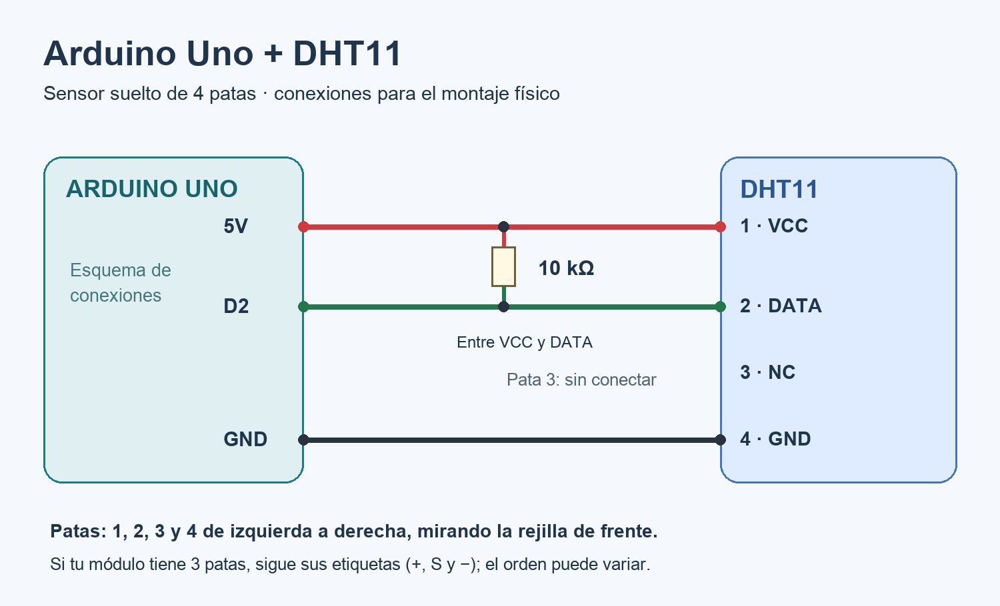
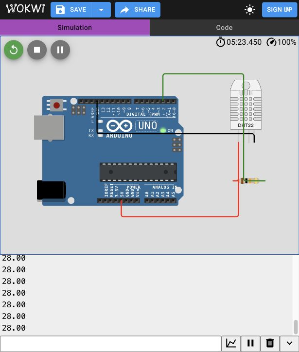

# Arduino Uno + DHT11: temperatura en MQTT, InfluxDB y Grafana

Esta es una implementación nueva basada en la arquitectura del PDF. El informe usaba un generador en Python; aquí el Arduino lee el sensor y Python actúa como puente USB. Los datos del montaje físico serán mediciones; los del simulador son valores de prueba. La placa prevista es el Uno R3 clasico.

**Recorrido:** DHT11 -> Arduino Uno -> USB -> Python en el Mac -> EMQX/MQTT -> Telegraf -> InfluxDB -> Grafana.

La computadora debe permanecer encendida, conectada por USB y ejecutando el puente. No hace falta comprar un módulo Wi-Fi para esta solución. Se conserva el tópico `iot/raspberrypi/temperatura` para mantener la compatibilidad con el informe, aunque el dispositivo ahora sea un Arduino.

## 1. Materiales y conexión física



- Arduino Uno y cable USB que permita transmitir datos.
- DHT11.
- Protoboard y cables jumper.
- Resistencia de 10 kOhm si el sensor no lleva resistencia incorporada.

Desconecta el USB mientras colocas los cables. Como aun no sabemos si tu DHT11 tiene 3 o 4 patas, identifica su presentación antes de conectar la alimentación.

### DHT11 en módulo de 3 patas

Sigue las etiquetas impresas del módulo; el orden de las patas puede variar.

| Etiqueta del módulo | Arduino Uno |
| --- | --- |
| VCC o + | 5V |
| GND o - | GND |
| DATA, OUT o S | Pin digital 2 (D2) |

Los módulos normalmente incluyen una resistencia entre alimentación y señal. Comprueba que la lleva; si no, coloca una de 10 kOhm entre VCC y DATA. Si las etiquetas no son legibles, identifica el módulo antes de alimentarlo.

### DHT11 suelto de 4 patas

Mirando la rejilla de frente y con las patas hacia abajo, numera de izquierda a derecha:

| Pata | Funcion | Conexión |
| --- | --- | --- |
| 1 | VCC | 5V del Uno |
| 2 | DATA | D2 del Uno |
| 3 | NC | Dejar sin conectar |
| 4 | GND | GND del Uno |

Coloca una resistencia de **10 kOhm entre las patas 1 y 2**. No va en serie con el cable de datos. En la protoboard, cada pata debe quedar en una fila eléctrica distinta.

## 2. Cargar el programa en el Uno

1. Instala o abre [Arduino IDE](https://www.arduino.cc/en/software/).
2. En el gestor de bibliotecas instala **DHT sensor library**, de Adafruit, y **Adafruit Unified Sensor**.
3. Abre `arduino/temperatura_dht11/temperatura_dht11.ino`.
4. Conecta el Uno por USB. En Herramientas elige **Arduino Uno** y el puerto de la placa.
5. Sube el programa y abre el Monitor Serie a **9600 baudios**.
6. Espera 10 segundos. Debe aparecer un número como `25.00`, y luego una lectura cada 10 segundos. Ese número es un ejemplo, no una temperatura esperada.

El programa esta configurado para **DHT11** y **D2**. Si aparece `ERR_DHT`, revisa el tipo de sensor, la alimentación, la resistencia y las etiquetas de las patas.

**Cierra el Monitor Serie antes de ejecutar Python:** el monitor y el puente no deben ocupar el mismo puerto simultaneamente. Tambien cierralo antes de volver a cargar un programa.

## 3. Preparar MQTT, InfluxDB y Grafana en el Mac

Necesitas [Docker Desktop para Mac](https://docs.docker.com/desktop/setup/install/mac-install/) y [Python 3](https://www.python.org/downloads/macos/). Docker debe estar abierto y haber terminado de iniciar. Las imagenes del proyecto usan las versiones del informe, no la etiqueta `latest`.

Descomprime el paquete. Abre Terminal y escribe `cd `, arrastra la carpeta `arduino_iot_mac` a la ventana y pulsa Enter. Así trabajas en la carpeta correcta aunque su ruta tenga espacios.

Ejecuta estas instrucciones, una por una:

```sh
python3 preparar.py
docker compose up -d
docker compose ps
```

La primera instrucción crea `.env` con contraseñas aleatorias y el token de InfluxDB. La segunda descarga e inicia los cuatro servicios. La primera descarga puede tardar varios minutos. Espera hasta que los cuatro aparezcan funcionando; InfluxDB incluye una comprobación de estado.

Las credenciales se consultan abriendo el archivo `.env` local. En Finder puedes mostrar archivos ocultos con **Command + Shift + .**. No compartas ese archivo ni regeneres las credenciales después de inicializar los volumenes: las cuentas ya creadas conservan sus claves.

| Aplicacion | Direccion predeterminada | Acceso |
| --- | --- | --- |
| Grafana | http://127.0.0.1:3000/d/ta3-temperatura-arduino | Usuario `admin`; clave `GRAFANA_PASSWORD` de `.env` |
| InfluxDB | http://127.0.0.1:8086 | Usuario `admin`; clave `INFLUX_PASSWORD` de `.env` |
| Panel EMQX | http://127.0.0.1:18083 | Usuario `admin`; clave `EMQX_PASSWORD` de `.env` |

La fuente de datos y el dashboard de Grafana se configuran automáticamente. Verás última lectura, promedio, mínimo, máximo e historial. Mientras no ingresen temperaturas mostrarán ausencia de datos.

Los puertos quedan publicados solamente en este Mac (`127.0.0.1`). MQTT funciona sin usuario en este laboratorio local. El puente se ejecuta directamente en macOS, donde puede acceder al USB; no se introduce dentro de Docker.

Si un puerto ya esta ocupado, cambia el correspondiente `*_PORT` en `.env` antes del arranque. Si cambias `MQTT_HOST_PORT`, pasa ese mismo número al puente mediante `--mqtt-puerto`.

## 4. Enviar las lecturas reales a MQTT

En la misma carpeta del proyecto:

```sh
python3 -m venv .venv
source .venv/bin/activate
python -m pip install -r requirements.txt
python -m serial.tools.list_ports
```

Busca el puerto del Uno. Suele empezar por `/dev/cu.usbmodem` o `/dev/cu.usbserial`; puede tener otro nombre, por ejemplo `/dev/cu.wchusbserial...`, en placas compatibles. Usa el puerto que aparezca realmente en tu Mac.

Con el Monitor Serie cerrado, inicia el puente. **Sustituye el ejemplo de puerto por el tuyo:**

```sh
python puente_mqtt.py --puerto /dev/cu.usbmodem1101
```

Cuando una lectura llegue al broker aparecera un mensaje como:

```text
EMQX confirmo: 25.00 C -> iot/raspberrypi/temperatura
```

El contenido enviado a MQTT es solo `25.00`, sin `C`, sin texto y sin JSON. Se usa QoS 1. La confirmación acredita recepción por EMQX; comprueba aparte que la lectura este en InfluxDB y Grafana.

Abre Grafana y espera las primeras lecturas. Telegraf escribe por lotes cada 5 segundos y Grafana refresca cada 10 segundos; la lectura puede tardar un poco en aparecer. La marca temporal se asigna al recibir el dato, como en el informe.

### Probar sin Arduino: temperaturas simuladas

Para comprobar MQTT, InfluxDB y Grafana sin placa, con el entorno Python activado:

```sh
python simulador_temperatura.py
```

Publica una temperatura cercana a 24 °C cada 10 segundos en el mismo tópico y con el mismo formato que el puente. Opciones útiles: `--intervalo`, `--base`, `--cantidad 6` (para una prueba corta) y `--mqtt-puerto`. Son valores de prueba, no mediciones: no lo ejecutes al mismo tiempo que el puente, porque ambos escriben en el mismo tópico.

### Probar el puente sin Arduino: Uno virtual

`arduino_virtual.py` crea un puerto serial virtual que escribe lo mismo que el firmware (una lectura cada 10 segundos y, cada 6, un `ERR_DHT`). Así se prueba `puente_mqtt.py` tal como se usaría con la placa. En una Terminal:

```sh
python arduino_virtual.py
```

Muestra un puerto como `/dev/ttys001`. En otra Terminal, con el entorno activado:

```sh
python puente_mqtt.py --puerto /dev/ttys001
```

Usa el puerto que aparezca en tu pantalla. Detén primero el puente y después el Uno virtual con **Control + C**.

## 5. Simular el circuito

### Prueba sencilla en el navegador



Abre [un nuevo Arduino Uno en Wokwi](https://wokwi.com/projects/new/arduino-uno). Los archivos de la carpeta `simulador` estan preparados para esta prueba:

1. Copia `simulador/sketch.ino` al editor `sketch.ino` de Wokwi.
2. Copia `simulador/diagram.json` al editor `diagram.json`.
3. En **Library Manager** añade **DHT sensor library** y **Adafruit Unified Sensor**.
4. Pulsa el boton verde para iniciar. Tras 10 segundos aparece la primera lectura.
5. Haz clic en el sensor y cambia su temperatura. El siguiente número debe reflejar el cambio.

**Wokwi usa DHT22 en este ejemplo**, porque es el componente disponible en su lista oficial. El archivo del simulador esta configurado para DHT22; el archivo que subes al Uno físico esta configurado para DHT11. Esta simulación verifica lectura y comunicacion serial; no representa la precisión ni el comportamiento físico de tu DHT11.

El Uno del navegador no crea un puerto USB en el Mac. Por tanto, el puente no puede leerlo indicando `/dev/cu...`.

### Simular también el recorrido hasta Grafana

La carpeta `simulador` incluye la configuración para **Wokwi en VS Code**, que permite compartir el puerto serial simulado con Python. Esta opción requiere una licencia de Wokwi compatible; revisa sus [planes vigentes](https://wokwi.com/pricing) y una posible licencia educativa antes de usarla. La prueba en el navegador y el circuito físico no requieren contratar esta opción.

1. Instala VS Code y **Wokwi for VS Code** desde el gestor de extensiones. Activa la licencia de Wokwi siguiendo su [guia oficial](https://docs.wokwi.com/vscode/getting-started).
2. Abre la carpeta `simulador` como proyecto en VS Code.
3. El paquete ya incluye `firmware.hex`, compilado por Wokwi con el programa de temperatura. No necesitas compilarlo localmente para esta primera prueba.
4. Ejecuta **Wokwi: Start Simulator**. El archivo `wokwi.toml` habilita el puerto serial simulado en el puerto 4000.
5. En otra Terminal, desde la carpeta principal y con el entorno Python activado, ejecuta:

```sh
python puente_mqtt.py --puerto rfc2217://localhost:4000
```

Si modificas el código, vuelve a compilarlo en el navegador Wokwi y, desde su editor, pulsa **F1**, busca **Download Compiled Firmware** y sustituye `simulador/firmware.hex`. También se incluye `platformio.ini` para quien prefiera compilar con PlatformIO; en Macs con Apple Silicon ese compilador puede requerir Rosetta para ejecutar herramientas Intel.

Mantén la pestaña del simulador visible en VS Code; la simulación puede pausarse si queda oculta. Cambia la temperatura del DHT22 virtual y comprueba que llegue a Grafana. Ejecuta un solo puente a la vez para no mezclar lecturas físicas y simuladas en el mismo tópico.

## 6. Comprobar y detener

Para ver si Telegraf consume y guarda datos:

```sh
docker compose logs --tail 30 telegraf
```

En el explorador de datos de InfluxDB puedes usar esta consulta Flux:

```flux
from(bucket: "temperatura")
  |> range(start: -15m)
  |> filter(fn: (r) => r._measurement == "temperatura")
  |> filter(fn: (r) => r._field == "value")
  |> filter(fn: (r) => r.topic == "iot/raspberrypi/temperatura")
  |> sort(columns: ["_time"])
```

Para una evidencia de la exposicion, registra una lectura en el puente, ubica ese valor y su hora en InfluxDB y toma una captura de Grafana. El DHT11 puede repetir el mismo valor muchas veces; imprimir dos decimales no aumenta su precisión.

Detén el puente con **Control + C**. Para detener los servicios conservando los datos:

```sh
docker compose down
```

Cuando quieras retomarlos usa `docker compose up -d` y vuelve a iniciar el puente. Las lecturas adquiridas mientras el puente esta apagado no se guardan. Este ejemplo no tiene almacenamiento permanente de lecturas pendientes; cortes y reconexiones pueden ocasionar lecturas perdidas o duplicadas.

## Si aparece un error

En la prueba de compilación local de este Mac apareció `Bad CPU type in executable` con una herramienta Intel. Si también ocurre al usar Arduino IDE o PlatformIO, sigue el [procedimiento oficial de Apple para Rosetta](https://support.apple.com/es-es/102527). La simulación web y el firmware preparado permiten avanzar mientras resuelves esa compatibilidad.

| Problema | Acción |
| --- | --- |
| `ERR_DHT` | Revisa sensor DHT11, pin D2, GND, VCC y resistencia. Desconecta USB antes de cambiar cables. |
| No aparece el puerto | Comprueba el cable USB de datos, adaptador y selección del puerto en Arduino IDE. |
| Puerto ocupado | Cierra Monitor Serie, Serial Plotter y cualquier otro programa que use el Uno. |
| Docker no responde | Abre Docker Desktop y espera a que termine de iniciar. |
| EMQX no responde | Revisa `docker compose ps` y que MQTT use el puerto de `.env`. |
| Grafana muestra `No data` | Comprueba primero el puente, luego Telegraf e InfluxDB; espera las primeras muestras. |
| La última lectura desaparece | Ese panel solo consulta el ultimo minuto; confirma que sigue entrando información. |

## Fuentes técnicas

- [Arduino Uno R3](https://docs.arduino.cc/hardware/uno-rev3/).
- [Conexión de sensores DHT](https://learn.adafruit.com/dht/connecting-to-a-dhtxx-sensor) y [bibliotecas para Arduino](https://learn.adafruit.com/dht/using-a-dhtxx-sensor-with-arduino).
- [Hardware de Wokwi](https://docs.wokwi.com/getting-started/supported-hardware) y [puerto serial hacia Python](https://docs.wokwi.com/vscode/project-config).
- [pySerial](https://pyserial.readthedocs.io/en/latest/shortintro.html) y [Paho MQTT](https://eclipse.dev/paho/files/paho.mqtt.python/html/client.html).
- [Telegraf MQTT](https://docs.influxdata.com/telegraf/v1/input-plugins/mqtt_consumer/), [InfluxDB 2 en Docker](https://docs.influxdata.com/influxdb/v2/install/?t=Docker) y [provisión de Grafana](https://grafana.com/docs/grafana/latest/administration/provisioning/).

La configuración de los servicios esta preparada para ejecutarse. Consulta `VALIDACION.md` para distinguir las pruebas realizadas de las verificaciones que requieren el montaje físico o iniciar Docker.
